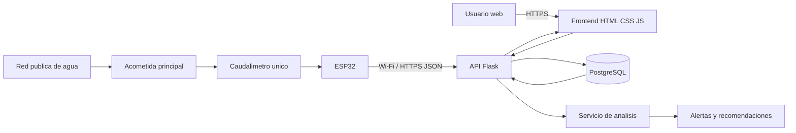

# Arquitectura final - AquaHogar

## Principios

- Un solo punto físico de medición por inmueble.
- Backend como única capa que escribe/consulta PostgreSQL.
- Claves y credenciales fuera del código mediante variables de entorno.
- Alertas basadas en línea base de consumo y flujo persistente.
- El sistema detecta anomalías generales; no localiza automáticamente el punto interno de una fuga.
